# GlucoIris — Project Report

**AI-assisted diabetic retinopathy screening with visible, reviewable evidence**

| | |
|---|---|
| Project type | Research prototype (Phase 1 workflow + Phase 2 model integration) |
| Report date | 14 October 2026 |
| Repository | `glucoiris-main/` (`frontend/`, `backend/`, `ml/`, `scripts/`) |
| Status | End-to-end working: web app ↔ inference service with four trained models |
| Intended use | Research and demonstration only — **not a medical device, not for clinical use** |

---

## Contents

1. [Summary](#1-summary)
2. [Problem and objectives](#2-problem-and-objectives)
3. [Tech stack](#3-tech-stack)
4. [System architecture](#4-system-architecture)
5. [Clinical workflow](#5-clinical-workflow)
6. [Approach](#6-approach)
7. [Methodology](#7-methodology)
8. [Results](#8-results)
9. [Discussion and limitations](#9-discussion-and-limitations)
10. [Future work](#10-future-work)
11. [How to run](#11-how-to-run)
12. [Repository map](#12-repository-map)
13. [Appendix A — draw.io workflow diagram (XML)](#appendix-a--drawio-workflow-diagram-xml)
14. [Appendix B — result files](#appendix-b--result-files)

---

## 1. Summary

GlucoIris is a clinician-facing web application that takes one retinal fundus photograph per screening and returns:

- an **image-quality verdict** (acceptable / borderline / ungradeable) with specific recapture guidance;
- a **binary DR decision** from a user-trained **EfficientNet-B4** (P(DR), threshold 0.5);
- a **five-class DR grade** from a user-trained **Vision Transformer (ViT-S/16)**;
- **Grad-CAM heatmaps and ranked bounding boxes** for both classifiers, showing where each model's evidence is concentrated;
- **lesion segmentation** (microaneurysms, haemorrhages, hard and soft exudates) with per-lesion boxes, from a **ResNet34 U-Net trained in this project on IDRiD**;
- a **retinal vessel mask** from a U-Net trained on DRIVE;
- a signed **report** with a large “DR detected / No DR detected” verdict, available on screen and as **PDF in English, Telugu and Hindi**.

Headline results (all on held-out data; details in [§8](#8-results)):

| Component | Data | Key result |
|---|---|---|
| Lesion U-Net (trained here) | IDRiD segmentation test set, 27 images | AUPR — hard exudates **0.859**, haemorrhages **0.685**, soft exudates **0.671**, microaneurysms **0.433** (mean **0.662**) |
| Vessel U-Net | DRIVE images 37–40 (held out) | AUC **0.983**, Dice **0.820**, sensitivity 0.853, specificity 0.968 |
| EfficientNet-B4 (DR vs no DR) | IDRiD grading test set, 103 images (external) | AUC **0.870**, sensitivity **94.2 %**, specificity 29.4 % at the trained threshold |
| ViT (five-class) | same 103 images (external) | QWK **0.490**, accuracy 41.7 %; referable-DR AUC **0.897** (sensitivity 90.6 %, specificity 56.4 %) |
| Quality gate | 516 IDRiD + 40 DRIVE real images, 286 synthetic degradations | 7 of 11 degradation types blocked (≥ 25/26 ungradeable); 93 % of real IDRiD images pass |

Both DR classifiers were trained on APTOS 2019, so the IDRiD numbers are a **cross-dataset** test. They detect disease reliably (high sensitivity, AUC ≈ 0.87–0.90) but over-call DR at their default thresholds on this new camera/population — the main finding to act on before any further use.

---

## 2. Problem and objectives

Diabetic retinopathy (DR) is a leading cause of preventable blindness. Screening needs a fundus photograph, a trained grader, and a timely referral decision. Automated graders exist, but a bare score is hard for a clinician to trust or audit.

**Objectives**

1. One guided workflow from patient registration to signed report, usable without training.
2. Block unusable images early, with actionable recapture advice.
3. Run real trained models and show **evidence** (heatmaps, boxes, lesion masks) next to every prediction.
4. Keep model output and clinician sign-off separate and auditable.
5. Make the result obvious (DR or not) and available in the patient's language (English, Telugu, Hindi).
6. Be honest: missing models are shown as *unavailable*, demo output is labelled *simulated*, nothing is fabricated.

---

## 3. Tech stack

### 3.1 Frontend (`frontend/`)

| Area | Technology | Version | Used for |
|---|---|---|---|
| Language | TypeScript | 7.0.2 | Type-safe UI and domain model |
| UI library | React | 19.3.0 | Components, pages |
| Build tool | Vite | 8.3.4 | Dev server, production build |
| Styling | Tailwind CSS (v4, `@theme` tokens) | 4.3.3 | Light/dark themes, glass-morphic tiles |
| Routing | React Router | 7.18.4 | 5-step screening routes, unsaved-change blocker |
| State | Zustand (+ `persist`) | 5.0.15 | Patients, encounters, jobs, reports, audit log |
| Image storage | idb-keyval (IndexedDB) | 6.3.0 | Uploaded fundus images (blobs) |
| PDF | jsPDF (+ canvas text shaping for Indic scripts) | 4.2.1 | Signed multilingual report |
| Animation | Motion; custom canvas “optical fibre” field | 14.1.0 | Landing and workspace background |
| Icons | lucide-react | 1.56.0 | UI icons |
| Fonts | Exo 2, Noto Sans Telugu, Noto Sans Devanagari | — | Latin + Telugu + Hindi text |
| i18n | Custom (`src/lib/i18n.ts`) — English text as key | — | EN / తెలుగు / हिन्दी, 618 strings |

### 3.2 Inference service and ML (`backend/`, `ml/`)

| Area | Technology | Version | Used for |
|---|---|---|---|
| Language | Python | 3.12 | Service and training |
| API | FastAPI + Uvicorn | 0.143 / 0.54 | `/v1/health`, `/v1/quality`, `/v1/analyze`, static artifacts |
| Deep learning | PyTorch, torchvision | 2.14.1 / 0.29.1 | EfficientNet-B4, U-Nets, training |
| Transformers | timm | 1.0.30 | ViT-S/16 backbone |
| Image processing | OpenCV, NumPy, Pillow | 5.0 / 2.5 / 12.3 | Cropping, CLAHE, quality metrics, overlays, boxes |
| Explainability | Grad-CAM (custom, B4 and ViT) + `cam_boxes.py` | — | Heatmaps and ranked evidence boxes |
| Hardware | Apple-silicon GPU (MPS) for training; CPU for inference | — | Lesion U-Net trained locally in 67 min |

### 3.3 Data

| Dataset | Content | Used for |
|---|---|---|
| APTOS 2019 (Kaggle) | ~3,600 graded fundus images (0–4) | Training EfficientNet-B4 and ViT (user, in Colab) |
| IDRiD — Disease Grading | 413 train / 103 test images, DR grade 0–4 | Quality calibration; **external test of B4 and ViT** |
| IDRiD — A. Segmentation | 54 train / 27 test images, pixel masks MA/HE/EX/SE | **Training and testing the lesion U-Net** |
| DRIVE | 40 images with manual vessel masks | Training/validating the vessel U-Net; quality calibration |

---

## 4. System architecture

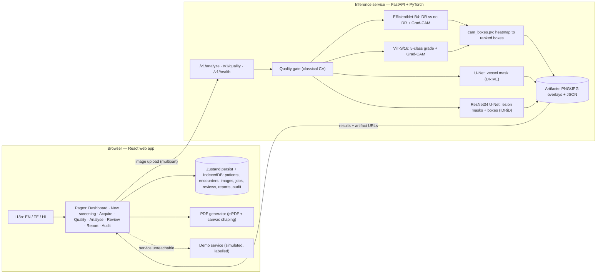

**Design choices**

- **Optional service.** The web app checks `GET /v1/health`. If the service is down it switches to a scripted demo service whose output is labelled *SIMULATED* everywhere, including the PDF.
- **Every module is optional.** A missing weights file makes that module *unavailable* with a reason; another module's output is never substituted.
- **Pixel-aligned evidence.** All heatmaps, masks and boxes are mapped back through the crop/pad into the **original image frame**, so overlays line up exactly in the viewer and the report.

---

## 5. Clinical workflow

### 5.1 End-to-end flow (Mermaid)

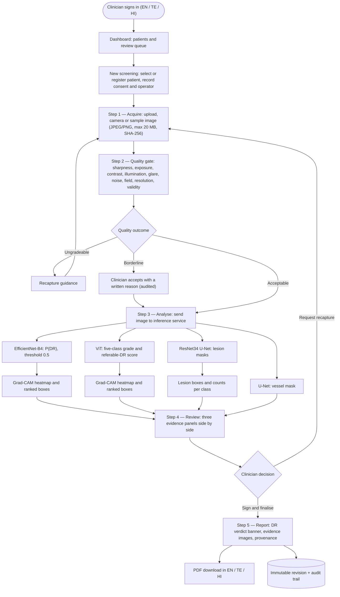

### 5.2 One analysis request (Mermaid sequence)

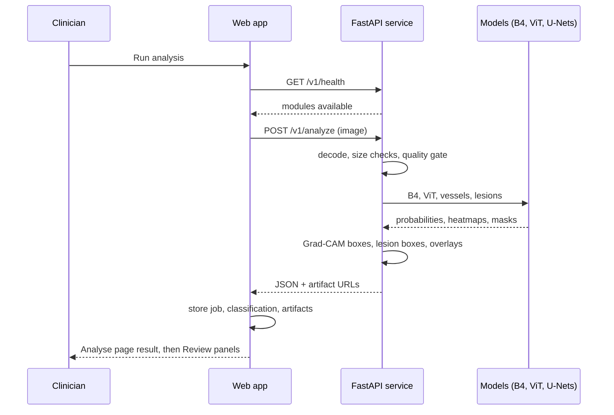

### 5.3 draw.io version

A full swim-lane diagram (web app / inference service / browser storage) is in **`docs/GlucoIris_workflow.drawio`**. Open it at <https://app.diagrams.net> → *File → Open from → Device*, or paste the XML in [Appendix A](#appendix-a--drawio-workflow-diagram-xml) via *Extras → Edit Diagram*.

---

## 6. Approach

1. **Workflow first, models second.** The clinical flow (register → acquire → quality → analyse → review → report) was built and tested with a scripted demo service. Real models were then plugged in behind the same interface, so the UI never depends on a particular model.
2. **Two complementary classifiers.** A binary EfficientNet-B4 answers the screening question (*is there DR?*); a five-class ViT gives severity and a referable-DR score. Both are shown, and **disagreement is surfaced** rather than hidden.
3. **Evidence for every claim.** Each classifier has its own Grad-CAM view with ranked boxes. Lesion segmentation adds clinically meaningful findings that are independent of the classifiers.
4. **Gate before grade.** Poor images are stopped before classification, because a confident prediction on an unusable image is worse than no prediction.
5. **Honest by design.** Missing models are *unavailable*, demo output is *simulated*, and thresholds and limitations are printed on every report.
6. **Usable by real clinics.** A fixed bottom step bar (Back / Continue at the same spot), no page scrolling on screening steps, a clear verdict banner, and three languages.

---

## 7. Methodology

### 7.1 Image intake

- Accepted: JPEG/PNG, up to 20 MB, short side ≥ 256 px. A SHA-256 checksum is stored with each image.
- Sources: file upload, browser camera (with permission handling and a fallback), or bundled IDRiD/DRIVE samples.
- One retinal fundus image per screening; replacing an image creates a new record and resets the screening to the quality step.

### 7.2 Quality gate (classical computer vision)

| Dimension | Measurement |
|---|---|
| Fundus validity | Circular retinal field with fundus colouring |
| Sharpness / focus | Variance of Laplacian, Tenengrad, FFT high-frequency ratio (log-scaled composite) |
| Brightness / exposure | Mean L\*, dark and clipped pixel fractions |
| Contrast | Green-channel dynamic range, vessel-scale difference-of-Gaussians contrast |
| Illumination uniformity | Coefficient of variation over a 4 × 4 grid |
| Glare | Saturated-blob fraction |
| Noise | Immerkær noise estimate |
| Field coverage | Retinal field fraction and edge visibility |
| Resolution | Short-side pixel count |

Each dimension is pass / warn / fail with a sentence of explanation and specific recapture advice. Thresholds were calibrated on IDRiD + DRIVE plus 11 synthetic degradations (blur, dark, overexposed, glare, noise, cropped, low contrast, uneven illumination, not-a-fundus). The same algorithm runs in the browser (TypeScript) and in the service (Python).

### 7.3 EfficientNet-B4 — binary DR detection (user-trained)

- Data: APTOS 2019, 70/15/15 stratified split (seed 42); DR = grades 1–4.
- Preprocessing: *CropFundus* (grey > 10 mask → bounding box + 2 % padding → centred square, black pad) → 380 × 380 → ImageNet normalisation.
- Head: torchvision `efficientnet_b4` with `classifier[1] = Linear(1792, 1)`; sigmoid → P(DR); threshold **0.5** as trained.
- Explainability: Grad-CAM on `features[-1]` (gradients of the single logit, channel-mean weights, ReLU, min–max), mapped back through the crop/pad to the original frame.

### 7.4 ViT — five-class DR grade (user-trained)

- Checkpoint `glucoiris_vit_best.pt`: `vit_small_patch16_224.augreg_in21k_ft_in1k` (timm), 5 classes, 224 px input.
- Preprocessing in the service: fundus crop → 224 px → normalise to [−1, 1].
- Outputs: softmax over grades 0–4; **referable score** = p2 + p3 + p4 (threshold 0.5); **determinable** only if the top-class probability ≥ 0.40 — otherwise the app shows *“Unable to determine — review required”* with the most likely grade.
- Explainability: Grad-CAM on the input of the last transformer block's attention (`blocks[-1].norm1`), patch tokens reshaped to the 14 × 14 grid, upsampled and smoothed.

### 7.5 From heatmap to evidence boxes (`ml/glucoiris_ml/cam_boxes.py`)

1. Keep pixels inside the retinal field with heat ≥ **0.5 × peak**.
2. Morphological closing; 8-connected components.
3. Drop components smaller than 0.3 % of the image.
4. Rank by **share of total heat**; keep the top 5.

Each box reports *peak heat* and *share of heat*. Boxes mark where the model's evidence is concentrated — **not verified lesions**; the UI says so.

### 7.6 Vessel segmentation (U-Net, DRIVE)

Compact U-Net (base 16, depth 4) on the CLAHE-enhanced green channel, with the fundus resized so the field diameter ≈ 540 px (DRIVE scale). Patch training with BCE + Dice. Trained on DRIVE 21–36, validated on 37–40 (DRIVE test masks are not public). Inference uses horizontal-flip test-time augmentation; threshold 0.8.

### 7.7 Lesion segmentation (ResNet34 U-Net, IDRiD) — trained in this project

| Setting | Value |
|---|---|
| Architecture | U-Net decoder on an ImageNet-pretrained ResNet34 encoder, 4 sigmoid outputs (MA, HE, EX, SE) |
| Input | Square fundus crop resized to 1024 px, ImageNet normalisation |
| Data split | 54 IDRiD training images → 46 train + 8 held-out validation; 27 official test images |
| Sampling | 512 px patches, 70 % centred on lesion pixels; flips, 90° rotations, brightness/contrast jitter |
| Loss | BCE with per-class positive weights (√ of the inverse lesion-pixel frequency, capped) + soft Dice |
| Optimiser | AdamW, lr 3 × 10⁻⁴, weight decay 10⁻⁴, one-cycle schedule |
| Training | 40 epochs × 90 iterations, batch 4, Apple-silicon GPU (MPS), 67 minutes |
| Model selection | Checkpoint with best validation mean AUPR (evaluated every 4 epochs) |
| Thresholds | Per class, chosen on **validation only** to maximise Dice: MA 0.55, HE 0.20, EX 0.45, SE 0.90 |
| Test protocol | Test set scored **once** with the validation thresholds; horizontal-flip test-time augmentation |
| Post-processing | Masks → class-wise connected components (with size limits and grouping) → bounding boxes on the original image |

### 7.8 Decision logic for the report

The report opens with one coloured banner per image:

- **Red — “Diabetic retinopathy detected”** if EfficientNet-B4 P(DR) ≥ 0.5;
- **Green — “No diabetic retinopathy detected”** otherwise;
- if B4 is unavailable, the ViT grade decides (only when determinable);
- **Amber — “Unable to screen” / “DR status not determined”** for ungradeable images or no model output.

The detail line lists B4 P(DR), the ViT grade, lesion counts per class, and **“the two models disagree — clinician review required”** when they do.

### 7.9 Review, sign-off and report

- Review shows three panels: Grad-CAM EfficientNet-B4, Grad-CAM ViT, and Lesions U-Net (mask + boxes + clickable counts per class).
- Finalising requires an explicit attestation; revisions are immutable and need a written reason; every action goes to the audit log.
- The PDF contains patient and encounter details, the verdict box, model outputs with provenance tags, all evidence images, missing modules, follow-up, reviewer, limitations and dataset credits, plus a demo/draft watermark.
- **Multilingual PDF:** jsPDF cannot shape Telugu or Devanagari, so for those languages each text line is rendered by the browser's text engine on a canvas and placed as an image. English PDFs keep selectable text.

### 7.10 User interface

- Five fixed steps: **Acquire · Quality · Analyse · Review · Report**, with a bottom bar where *Back* and *Continue* always sit in the same place.
- Screening steps fit the viewport (no page scrolling); long content scrolls inside its own panel.
- Light (default) and dark themes; glass-morphic tiles over an animated optical-fibre background.
- Language toggle **EN / తె / हि** on every page; dates use the chosen locale.

---

## 8. Results

### 8.1 Lesion segmentation — IDRiD test set (27 images, scored once)

| Lesion | Test AUPR | Test Dice | Validation AUPR | Validation Dice | Threshold |
|---|---|---|---|---|---|
| Hard exudates (EX) | **0.859** | **0.778** | 0.855 | 0.777 | 0.45 |
| Haemorrhages (HE) | **0.685** | **0.646** | 0.694 | 0.671 | 0.20 |
| Soft exudates (SE) | **0.671** | **0.663** | 0.735 | 0.732 | 0.90 |
| Microaneurysms (MA) | **0.433** | **0.478** | 0.376 | 0.458 | 0.55 |
| **Mean** | **0.662** | **0.641** | 0.665 | 0.660 | |

Validation mean AUPR during training: 0.29 (epoch 4) → 0.53 (8) → 0.60 (20) → 0.66 (36) → **0.665 (40, selected)**. Test and validation scores are close, so the model is not over-fitted to the 8 validation images. Hard exudates are segmented best; microaneurysms (a few pixels each) are the hardest, as expected.

### 8.2 Vessel segmentation — DRIVE 37–40 (held out)

| AUC | Dice | Sensitivity | Specificity | Accuracy | Best epoch | Threshold |
|---|---|---|---|---|---|---|
| **0.983** | **0.820** | 0.853 | 0.968 | 0.954 | 25 | 0.8 |

### 8.3 DR classifiers — external test on IDRiD (103 images)

Grade distribution: 0 → 34, 1 → 5, 2 → 32, 3 → 19, 4 → 13. Both models were trained on APTOS 2019 only.

**EfficientNet-B4 — DR vs no DR (threshold 0.5)**

| AUC | Sensitivity | Specificity | Accuracy | PPV | NPV | TP / FP / TN / FN |
|---|---|---|---|---|---|---|
| **0.870** | **94.2 %** | 29.4 % | 72.8 % | 73.0 % | 71.4 % | 65 / 24 / 10 / 4 |

**ViT — five-class grade**

| Accuracy | Macro-F1 | Quadratic weighted kappa |
|---|---|---|
| 41.7 % | 0.348 | **0.490** |

Per-class F1: grade 0 0.48 · grade 1 0.29 · grade 2 0.52 · grade 3 0.10 · grade 4 0.36.

Confusion matrix (rows = true grade, columns = predicted):

| true \ pred | 0 | 1 | 2 | 3 | 4 |
|---|---|---|---|---|---|
| **0** | 12 | 4 | 14 | 0 | 4 |
| **1** | 1 | 2 | 2 | 0 | 0 |
| **2** | 2 | 2 | 20 | 0 | 8 |
| **3** | 1 | 1 | 4 | 1 | 12 |
| **4** | 0 | 0 | 5 | 0 | 8 |

**ViT — derived screening decisions**

| Task | AUC | Sensitivity | Specificity | Accuracy |
|---|---|---|---|---|
| Any DR (argmax ≥ 1) | 0.895 | 94.2 % | 35.3 % | 74.8 % |
| Referable DR (p2+p3+p4 ≥ 0.5) | **0.897** | **90.6 %** | 56.4 % | 77.7 % |

**Threshold sensitivity (exploratory — chosen on the test set, so not a valid operating point)**

| Model / task | Threshold | Sensitivity | Specificity |
|---|---|---|---|
| B4, any DR | 0.5 (trained) | 94.2 % | 29.4 % |
| B4, any DR | 0.99 | 81.2 % | 82.4 % |
| ViT, referable | 0.5 (default) | 90.6 % | 56.4 % |
| ViT, referable | 0.7 | 79.7 % | 89.7 % |

Both models rank images well (AUC 0.87–0.90), but their default thresholds are too permissive on IDRiD. A threshold re-tuned on separate IDRiD-like validation data would trade a little sensitivity for much better specificity.

### 8.4 Quality gate

Real images:

| Dataset | Acceptable | Borderline | Ungradeable |
|---|---|---|---|
| IDRiD (516) | 478 (92.6 %) | 30 | 8 |
| DRIVE (40) | 0 | 39 (low resolution, 565 × 584) | 1 |

Synthetic degradations of 26 IDRiD images each:

| Degradation | Ungradeable | Borderline | Acceptable |
|---|---|---|---|
| Strong blur, very dark, glare, noise, not a fundus | 26 / 26 each | 0 | 0 |
| Dark | 25 | 1 | 0 |
| Overexposed | 25 | 1 | 0 |
| Cropped field | 2 | 24 | 0 |
| Low contrast | 3 | 23 | 0 |
| Mild blur | 1 | 15 | 10 |
| Uneven illumination | 2 | 12 | 12 |

Severe defects are reliably blocked. Mild blur and uneven illumination are sometimes passed — appropriate, since such images are often still gradeable.

### 8.5 Worked example — IDRiD_029 (reference grade 2, moderate NPDR)

| Output | Result |
|---|---|
| Quality | Acceptable (score 96.7) |
| EfficientNet-B4 | **DR detected**, P(DR) = 1.000; Grad-CAM box #1 holds 87 % of the heat over the central lesion area |
| ViT | Most likely *Moderate NPDR* (39 %) → “Unable to determine — review required”; referable score 0.94 (flagged); box #1 (69 % of heat) on the hard-exudate cluster |
| Lesion U-Net | 249 regions: 36 microaneurysms, 42 haemorrhages, 170 hard exudates, 1 soft exudate |
| Report banner | **Diabetic retinopathy detected** + ViT grade + lesion counts |

For contrast, a healthy fundus (`13_left_0.jpeg`) gave B4 P(DR) = 0.000005 and ViT *No DR* (66 %) → **No diabetic retinopathy detected**.

Grad-CAM with ranked boxes — EfficientNet-B4 (left) and ViT (right):

<p>
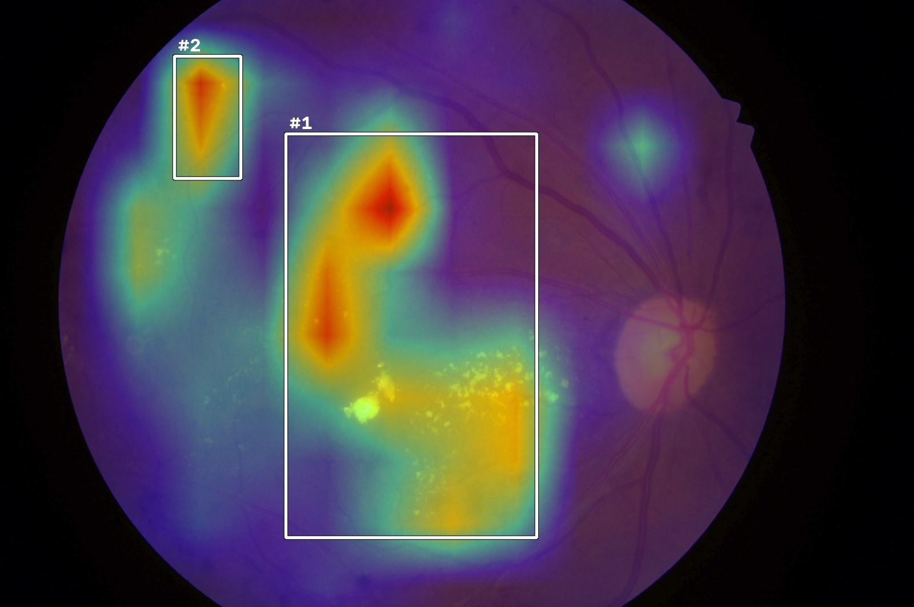
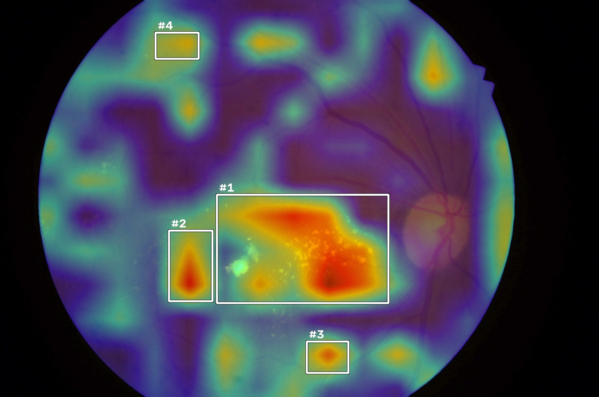
</p>

### 8.6 Runtime

| Operation | Time |
|---|---|
| B4 + ViT on one image (CPU) | ≈ 1.6 s (103 images in 169 s) |
| Full analysis: quality + B4 + ViT + vessels + lesions, with overlays (CPU) | 4.9–5.8 s per image |
| Lesion U-Net training (40 epochs, MPS) | 67 min |

### 8.7 Application screenshots

| Analyse | Review — three evidence panels |
|---|---|
| 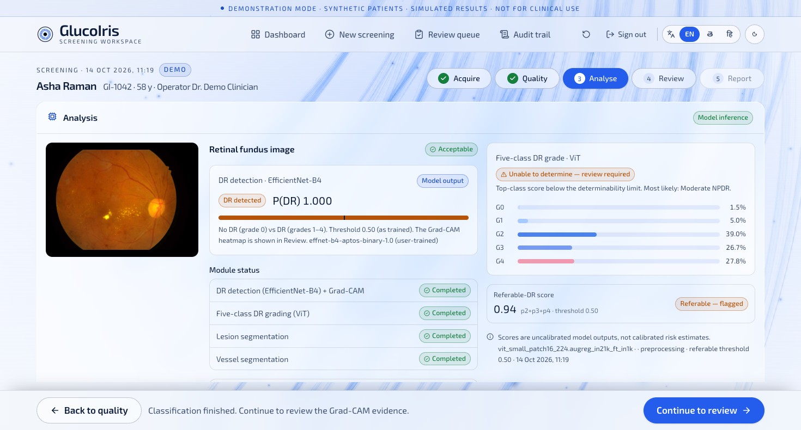 | 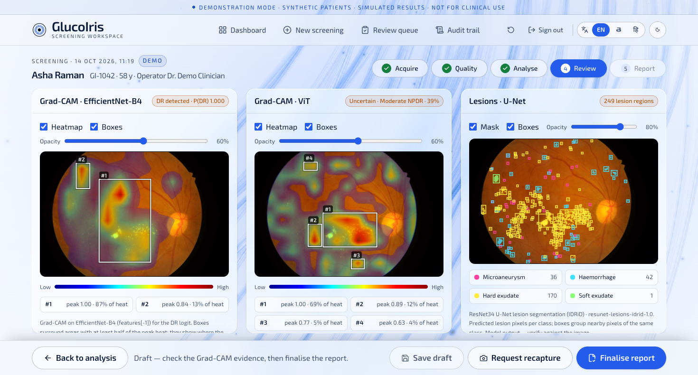 |

| Report with DR verdict | Report in Telugu |
|---|---|
| 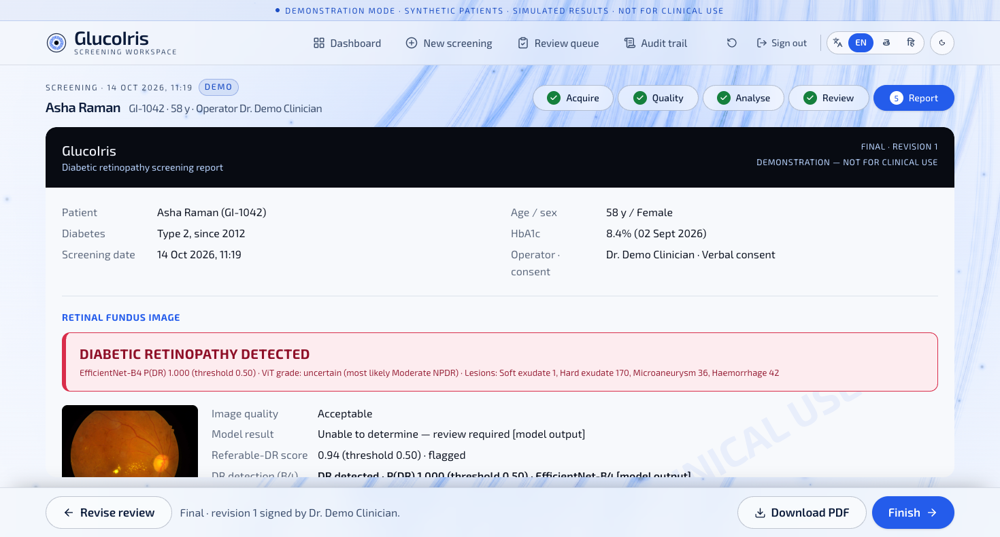 | 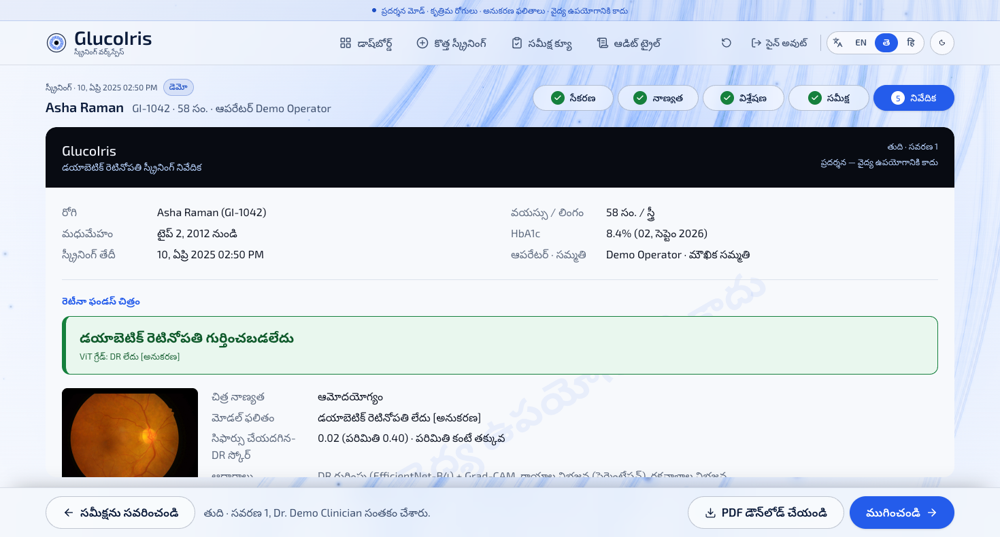 |

| Analyse in Hindi | PDF page 1 in Telugu |
|---|---|
| 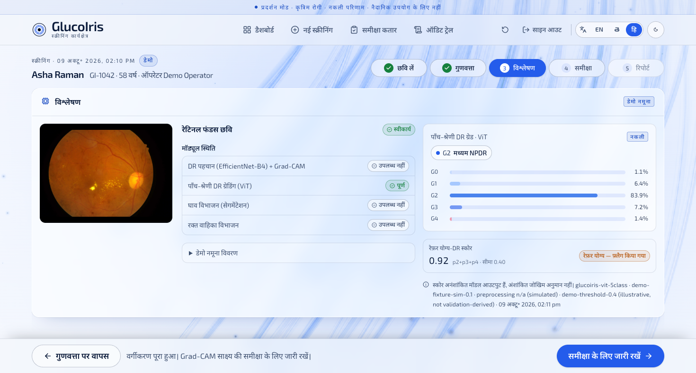 | 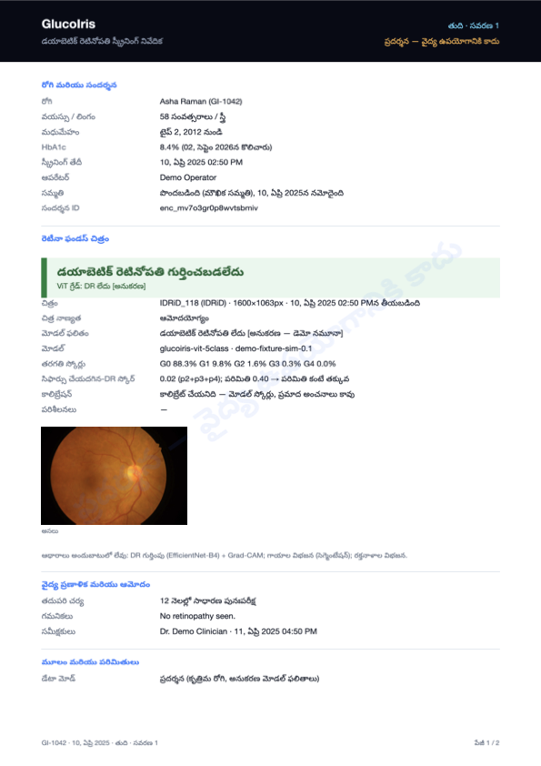 |

---

## 9. Discussion and limitations

- **Domain shift.** B4 and ViT were trained on APTOS (Indian clinics, varied cameras) and tested on IDRiD (one Indian clinic, one camera). AUCs of 0.87–0.90 show the models transfer, but the default thresholds over-call DR: 24 of 34 healthy eyes were flagged by B4. Thresholds should be re-calibrated on a validation set from the target site.
- **ViT confidence.** The ViT's top-class probability is often below 0.4 on IDRiD, so many images show “Unable to determine”. Severe NPDR (grade 3) is mostly predicted as proliferative (12 of 19). Temperature scaling and grade-specific fine-tuning on IDRiD would help.
- **Small lesion dataset.** Only 54 training images; microaneurysm AUPR (0.43) reflects how small and sparse they are. More data (e.g. DDR, FGADR) and higher resolution for MA would help.
- **Grad-CAM is not lesion detection.** Heatmaps and boxes show where the model's evidence lies; they can highlight artefacts. They are labelled as such everywhere.
- **No clinical validation or regulatory clearance.** All results are research results on public datasets.
- **Storage is browser-local in demo mode.** Patient data lives in the browser; a real deployment needs server-side storage, authentication and access control.
- **Translations** were written for this prototype and should be reviewed by native Telugu and Hindi clinical speakers. Model names and medical acronyms stay in English.

---

## 10. Future work

1. Re-calibrate B4 and ViT thresholds on an IDRiD/clinic validation split (target ≥ 90 % sensitivity at the best specificity).
2. Fine-tune the ViT on IDRiD; add temperature scaling.
3. Train the lesion U-Net on more data (IDRiD + DDR); dedicated microaneurysm head at full resolution.
4. Add a clinician grade and macular-oedema entry to Review, and track model–clinician agreement.
5. Server-side database (PostgreSQL), object storage for images, real authentication, worker queue.
6. Prospective evaluation with local graders; device-specific analysis using the recorded camera field.

---

## 11. How to run

```bash
# 1. Frontend
cd frontend
npm install
npm run dev                    # http://localhost:5173 (or the port Vite prints)

# 2. Inference service (macOS, Python 3.12 venv in the repo)
python3.12 -m venv ../.venv && ../.venv/bin/pip install -r ../requirements.txt
npm run backend:mac            # http://localhost:8000  (GET /v1/health)

# 3. Train the lesion U-Net (IDRiD "A. Segmentation")
../.venv/bin/python ../ml/train_lesions_idrid.py --data "~/Downloads/A. Segmentation" \
  --epochs 40 --iters 90 --batch 4 --size 1024 --patch 512

# 4. Evaluate B4 + ViT on the IDRiD grading test set
../.venv/bin/python ../ml/evaluate_idrid_grading.py \
  --images "<Disease Grading>/1. Original Images/b. Testing Set" \
  --labels "<Disease Grading>/2. Groundtruths/b. IDRiD_Disease Grading_Testing Labels.csv"
```

Model weights expected in `ml/weights/`:

| File | Model |
|---|---|
| `effnet_b4_dr_binary.pth` | EfficientNet-B4, DR vs no DR |
| `glucoiris_vit_best.pt` | ViT-S/16, five-class grade |
| `unet_drive.pt` | Vessel U-Net |
| `unet_lesions_idrid.pt` | Lesion ResNet34 U-Net (trained in this project) |

---

## 12. Repository map

```
glucoiris-main/
├── frontend/                     React + TypeScript web app
│   └── src/
│       ├── pages/                Landing, Login, Dashboard, Patient, NewScreening,
│       │                         Acquisition, Quality, Analysis, Review, Report, Audit
│       ├── features/             screening steps, viewer (GradCamPanel, LesionPanel),
│       │                         reports (reportModel, pdf), landing animation
│       ├── services/             model-service client, screening API (model + demo)
│       ├── lib/                  i18n (EN/TE/HI), quality heuristic, overlays, theme
│       └── store/                Zustand store (patients → reports, audit)
├── backend/app/main.py           FastAPI inference service
├── ml/
│   ├── glucoiris_ml/             inference pipeline, effnet (B4 + Grad-CAM), explain (ViT Grad-CAM),
│   │                             cam_boxes, lesions, models, preprocess, quality, metrics
│   ├── train_lesions_idrid.py    lesion U-Net training (CUDA / MPS / CPU)
│   ├── train_vessels_drive.py    vessel U-Net training
│   ├── evaluate_idrid_grading.py external evaluation of B4 + ViT
│   ├── weights/                  model checkpoints
│   └── reports/                  JSON metrics (lesions, vessels, quality, IDRiD grading)
└── docs/
    ├── GlucoIris_Project_Report.md   this report
    ├── GlucoIris_workflow.drawio     draw.io workflow diagram
    └── screenshots/                  figures used in this report
```

---

## Appendix A — draw.io workflow diagram (XML)

Save as `GlucoIris_workflow.drawio`, or in draw.io use *Extras → Edit Diagram* and paste.

```xml
<mxfile host="app.diagrams.net" agent="GlucoIris report" version="24.7.17">
  <diagram id="glucoiris-workflow" name="GlucoIris workflow">
    <mxGraphModel dx="1600" dy="1000" grid="1" gridSize="10" guides="1" tooltips="1" connect="1" arrows="1" fold="1" page="1" pageScale="1" pageWidth="1900" pageHeight="1150" math="0" shadow="0">
      <root>
        <mxCell id="0" />
        <mxCell id="1" parent="0" />

        <!-- Swimlanes -->
        <mxCell id="laneUI" value="Clinician + React web app (frontend/)" style="swimlane;horizontal=0;startSize=34;fillColor=#E8F0FE;strokeColor=#245CEB;fontStyle=1;fontSize=14;" vertex="1" parent="1">
          <mxGeometry x="20" y="20" width="1860" height="430" as="geometry" />
        </mxCell>
        <mxCell id="laneAPI" value="Inference service — FastAPI + PyTorch (backend/, ml/)" style="swimlane;horizontal=0;startSize=34;fillColor=#FFF4E5;strokeColor=#B45309;fontStyle=1;fontSize=14;" vertex="1" parent="1">
          <mxGeometry x="20" y="470" width="1860" height="470" as="geometry" />
        </mxCell>
        <mxCell id="laneStore" value="Browser storage (zustand persist + IndexedDB)" style="swimlane;horizontal=0;startSize=34;fillColor=#EAF7EE;strokeColor=#15803D;fontStyle=1;fontSize=14;" vertex="1" parent="1">
          <mxGeometry x="20" y="960" width="1860" height="160" as="geometry" />
        </mxCell>

        <!-- Frontend steps -->
        <mxCell id="login" value="Login / demo access&lt;br&gt;&lt;i&gt;EN · తెలుగు · हिन्दी&lt;/i&gt;" style="rounded=1;whiteSpace=wrap;html=1;fillColor=#FFFFFF;strokeColor=#245CEB;fontSize=12;" vertex="1" parent="laneUI">
          <mxGeometry x="60" y="40" width="160" height="60" as="geometry" />
        </mxCell>
        <mxCell id="dash" value="Dashboard&lt;br&gt;patients · review queue" style="rounded=1;whiteSpace=wrap;html=1;fillColor=#FFFFFF;strokeColor=#245CEB;fontSize=12;" vertex="1" parent="laneUI">
          <mxGeometry x="60" y="150" width="160" height="60" as="geometry" />
        </mxCell>
        <mxCell id="newscr" value="New screening&lt;br&gt;register patient · consent · operator" style="rounded=1;whiteSpace=wrap;html=1;fillColor=#FFFFFF;strokeColor=#245CEB;fontSize=12;" vertex="1" parent="laneUI">
          <mxGeometry x="60" y="260" width="160" height="70" as="geometry" />
        </mxCell>
        <mxCell id="acq" value="&lt;b&gt;1 · Acquire&lt;/b&gt;&lt;br&gt;upload · camera · sample&lt;br&gt;JPEG/PNG ≤ 20 MB, SHA-256" style="rounded=1;whiteSpace=wrap;html=1;fillColor=#DCE7FD;strokeColor=#245CEB;fontSize=12;" vertex="1" parent="laneUI">
          <mxGeometry x="290" y="255" width="180" height="80" as="geometry" />
        </mxCell>
        <mxCell id="qual" value="&lt;b&gt;2 · Quality gate&lt;/b&gt;&lt;br&gt;sharpness · exposure · contrast · glare · noise · field · resolution · validity" style="rounded=1;whiteSpace=wrap;html=1;fillColor=#DCE7FD;strokeColor=#245CEB;fontSize=12;" vertex="1" parent="laneUI">
          <mxGeometry x="540" y="255" width="200" height="80" as="geometry" />
        </mxCell>
        <mxCell id="qdec" value="Outcome?" style="rhombus;whiteSpace=wrap;html=1;fillColor=#FFFFFF;strokeColor=#245CEB;fontSize=12;" vertex="1" parent="laneUI">
          <mxGeometry x="800" y="250" width="110" height="90" as="geometry" />
        </mxCell>
        <mxCell id="recap" value="Ungradeable&lt;br&gt;→ recapture guidance&lt;br&gt;(or review as “Unable to screen”)" style="rounded=1;whiteSpace=wrap;html=1;fillColor=#FDECEF;strokeColor=#D92D4A;fontSize=11;" vertex="1" parent="laneUI">
          <mxGeometry x="770" y="60" width="170" height="70" as="geometry" />
        </mxCell>
        <mxCell id="border" value="Borderline&lt;br&gt;→ clinician accepts with a reason (audited)" style="rounded=1;whiteSpace=wrap;html=1;fillColor=#FDF3E6;strokeColor=#B45309;fontSize=11;" vertex="1" parent="laneUI">
          <mxGeometry x="560" y="60" width="170" height="70" as="geometry" />
        </mxCell>
        <mxCell id="ana" value="&lt;b&gt;3 · Analyse&lt;/b&gt;&lt;br&gt;job per image · module status&lt;br&gt;B4 result + ViT grade" style="rounded=1;whiteSpace=wrap;html=1;fillColor=#DCE7FD;strokeColor=#245CEB;fontSize=12;" vertex="1" parent="laneUI">
          <mxGeometry x="980" y="255" width="190" height="80" as="geometry" />
        </mxCell>
        <mxCell id="rev" value="&lt;b&gt;4 · Review&lt;/b&gt;&lt;br&gt;Grad-CAM B4 · Grad-CAM ViT · Lesions U-Net&lt;br&gt;heatmaps + boxes · sign &amp;amp; finalise" style="rounded=1;whiteSpace=wrap;html=1;fillColor=#DCE7FD;strokeColor=#245CEB;fontSize=12;" vertex="1" parent="laneUI">
          <mxGeometry x="1240" y="255" width="220" height="80" as="geometry" />
        </mxCell>
        <mxCell id="rep" value="&lt;b&gt;5 · Report&lt;/b&gt;&lt;br&gt;DR verdict banner · evidence images&lt;br&gt;PDF in EN / TE / HI" style="rounded=1;whiteSpace=wrap;html=1;fillColor=#DCE7FD;strokeColor=#245CEB;fontSize=12;" vertex="1" parent="laneUI">
          <mxGeometry x="1530" y="255" width="210" height="80" as="geometry" />
        </mxCell>
        <mxCell id="verdict" value="DR detected / No DR detected&lt;br&gt;(+ ViT grade, lesion counts,&lt;br&gt;model disagreement flag)" style="shape=note;whiteSpace=wrap;html=1;fillColor=#FFFFFF;strokeColor=#15803D;fontSize=11;size=14;" vertex="1" parent="laneUI">
          <mxGeometry x="1540" y="60" width="190" height="80" as="geometry" />
        </mxCell>

        <!-- Backend -->
        <mxCell id="api" value="&lt;b&gt;POST /v1/analyze&lt;/b&gt;&lt;br&gt;decode · size checks · quality gate&lt;br&gt;(GET /v1/health · POST /v1/quality)" style="rounded=1;whiteSpace=wrap;html=1;fillColor=#FFFFFF;strokeColor=#B45309;fontSize=12;" vertex="1" parent="laneAPI">
          <mxGeometry x="560" y="40" width="230" height="80" as="geometry" />
        </mxCell>
        <mxCell id="b4" value="&lt;b&gt;EfficientNet-B4&lt;/b&gt; (binary)&lt;br&gt;CropFundus → 380 px → P(DR), t = 0.5&lt;br&gt;Grad-CAM on features[-1]" style="rounded=1;whiteSpace=wrap;html=1;fillColor=#FFE7C2;strokeColor=#B45309;fontSize=12;" vertex="1" parent="laneAPI">
          <mxGeometry x="80" y="180" width="250" height="80" as="geometry" />
        </mxCell>
        <mxCell id="vit" value="&lt;b&gt;ViT-S/16&lt;/b&gt; (5 classes)&lt;br&gt;fundus crop → 224 px → softmax&lt;br&gt;Grad-CAM on last block" style="rounded=1;whiteSpace=wrap;html=1;fillColor=#FFE7C2;strokeColor=#B45309;fontSize=12;" vertex="1" parent="laneAPI">
          <mxGeometry x="380" y="180" width="250" height="80" as="geometry" />
        </mxCell>
        <mxCell id="ves" value="&lt;b&gt;U-Net&lt;/b&gt; vessels (DRIVE)&lt;br&gt;CLAHE green channel&lt;br&gt;vessel mask + density" style="rounded=1;whiteSpace=wrap;html=1;fillColor=#FFE7C2;strokeColor=#B45309;fontSize=12;" vertex="1" parent="laneAPI">
          <mxGeometry x="680" y="180" width="230" height="80" as="geometry" />
        </mxCell>
        <mxCell id="les" value="&lt;b&gt;ResNet34 U-Net&lt;/b&gt; lesions (IDRiD)&lt;br&gt;MA · HE · EX · SE masks&lt;br&gt;→ connected components → boxes" style="rounded=1;whiteSpace=wrap;html=1;fillColor=#FFE7C2;strokeColor=#B45309;fontSize=12;" vertex="1" parent="laneAPI">
          <mxGeometry x="960" y="180" width="250" height="80" as="geometry" />
        </mxCell>
        <mxCell id="cam" value="&lt;b&gt;cam_boxes.py&lt;/b&gt;&lt;br&gt;heat ≥ 0.5 × peak in retinal field → components → top-5 ranked boxes" style="rounded=1;whiteSpace=wrap;html=1;fillColor=#FFFFFF;strokeColor=#B45309;fontSize=11;" vertex="1" parent="laneAPI">
          <mxGeometry x="230" y="320" width="260" height="70" as="geometry" />
        </mxCell>
        <mxCell id="arts" value="&lt;b&gt;Artifacts&lt;/b&gt; (backend/artifacts)&lt;br&gt;heatmap PNGs · blended JPGs · boxed JPGs · masks&lt;br&gt;JSON: probabilities, regions, boxes, module status" style="rounded=1;whiteSpace=wrap;html=1;fillColor=#FFFFFF;strokeColor=#B45309;fontSize=11;" vertex="1" parent="laneAPI">
          <mxGeometry x="1300" y="300" width="300" height="90" as="geometry" />
        </mxCell>
        <mxCell id="demo" value="No server? → Demo service&lt;br&gt;scripted, clearly labelled SIMULATED results for bundled samples" style="rounded=1;whiteSpace=wrap;html=1;dashed=1;fillColor=#F3F4F6;strokeColor=#6B7280;fontSize=11;" vertex="1" parent="laneAPI">
          <mxGeometry x="1300" y="40" width="300" height="70" as="geometry" />
        </mxCell>

        <!-- Storage -->
        <mxCell id="db" value="Patients · encounters · images · quality · jobs · classifications · artifacts · reviews · reports (immutable revisions) · audit log" style="rounded=1;whiteSpace=wrap;html=1;fillColor=#FFFFFF;strokeColor=#15803D;fontSize=12;" vertex="1" parent="laneStore">
          <mxGeometry x="560" y="40" width="760" height="70" as="geometry" />
        </mxCell>

        <!-- Edges -->
        <mxCell id="e1" style="endArrow=block;html=1;strokeColor=#245CEB;" edge="1" parent="1" source="login" target="dash"><mxGeometry relative="1" as="geometry" /></mxCell>
        <mxCell id="e2" style="endArrow=block;html=1;strokeColor=#245CEB;" edge="1" parent="1" source="dash" target="newscr"><mxGeometry relative="1" as="geometry" /></mxCell>
        <mxCell id="e3" style="endArrow=block;html=1;strokeColor=#245CEB;" edge="1" parent="1" source="newscr" target="acq"><mxGeometry relative="1" as="geometry" /></mxCell>
        <mxCell id="e4" style="endArrow=block;html=1;strokeColor=#245CEB;" edge="1" parent="1" source="acq" target="qual"><mxGeometry relative="1" as="geometry" /></mxCell>
        <mxCell id="e5" style="endArrow=block;html=1;strokeColor=#245CEB;" edge="1" parent="1" source="qual" target="qdec"><mxGeometry relative="1" as="geometry" /></mxCell>
        <mxCell id="e6" value="ungradeable" style="endArrow=block;html=1;strokeColor=#D92D4A;fontSize=11;" edge="1" parent="1" source="qdec" target="recap"><mxGeometry relative="1" as="geometry" /></mxCell>
        <mxCell id="e7" value="borderline" style="endArrow=block;html=1;strokeColor=#B45309;fontSize=11;" edge="1" parent="1" source="qdec" target="border"><mxGeometry relative="1" as="geometry" /></mxCell>
        <mxCell id="e8" value="acceptable" style="endArrow=block;html=1;strokeColor=#15803D;fontSize=11;" edge="1" parent="1" source="qdec" target="ana"><mxGeometry relative="1" as="geometry" /></mxCell>
        <mxCell id="e9" value="accepted" style="endArrow=block;html=1;dashed=1;strokeColor=#B45309;fontSize=11;" edge="1" parent="1" source="border" target="ana"><mxGeometry relative="1" as="geometry" /></mxCell>
        <mxCell id="e10" value="recapture" style="endArrow=block;html=1;dashed=1;strokeColor=#D92D4A;fontSize=11;" edge="1" parent="1" source="recap" target="acq"><mxGeometry relative="1" as="geometry" /></mxCell>
        <mxCell id="e11" style="endArrow=block;html=1;strokeColor=#245CEB;" edge="1" parent="1" source="ana" target="rev"><mxGeometry relative="1" as="geometry" /></mxCell>
        <mxCell id="e12" value="sign &amp;amp; finalise" style="endArrow=block;html=1;strokeColor=#245CEB;fontSize=11;" edge="1" parent="1" source="rev" target="rep"><mxGeometry relative="1" as="geometry" /></mxCell>
        <mxCell id="e13" style="endArrow=block;html=1;dashed=1;strokeColor=#15803D;" edge="1" parent="1" source="rep" target="verdict"><mxGeometry relative="1" as="geometry" /></mxCell>
        <mxCell id="e14" value="image (multipart)" style="endArrow=block;html=1;strokeColor=#B45309;fontSize=11;" edge="1" parent="1" source="ana" target="api"><mxGeometry relative="1" as="geometry" /></mxCell>
        <mxCell id="e15" value="quality (when server is up)" style="endArrow=block;html=1;dashed=1;strokeColor=#B45309;fontSize=11;" edge="1" parent="1" source="qual" target="api"><mxGeometry relative="1" as="geometry" /></mxCell>
        <mxCell id="e16" style="endArrow=block;html=1;strokeColor=#B45309;" edge="1" parent="1" source="api" target="b4"><mxGeometry relative="1" as="geometry" /></mxCell>
        <mxCell id="e17" style="endArrow=block;html=1;strokeColor=#B45309;" edge="1" parent="1" source="api" target="vit"><mxGeometry relative="1" as="geometry" /></mxCell>
        <mxCell id="e18" style="endArrow=block;html=1;strokeColor=#B45309;" edge="1" parent="1" source="api" target="ves"><mxGeometry relative="1" as="geometry" /></mxCell>
        <mxCell id="e19" style="endArrow=block;html=1;strokeColor=#B45309;" edge="1" parent="1" source="api" target="les"><mxGeometry relative="1" as="geometry" /></mxCell>
        <mxCell id="e20" value="heatmap" style="endArrow=block;html=1;strokeColor=#B45309;fontSize=11;" edge="1" parent="1" source="b4" target="cam"><mxGeometry relative="1" as="geometry" /></mxCell>
        <mxCell id="e21" value="heatmap" style="endArrow=block;html=1;strokeColor=#B45309;fontSize=11;" edge="1" parent="1" source="vit" target="cam"><mxGeometry relative="1" as="geometry" /></mxCell>
        <mxCell id="e22" style="endArrow=block;html=1;strokeColor=#B45309;" edge="1" parent="1" source="cam" target="arts"><mxGeometry relative="1" as="geometry" /></mxCell>
        <mxCell id="e23" style="endArrow=block;html=1;strokeColor=#B45309;" edge="1" parent="1" source="ves" target="arts"><mxGeometry relative="1" as="geometry" /></mxCell>
        <mxCell id="e24" style="endArrow=block;html=1;strokeColor=#B45309;" edge="1" parent="1" source="les" target="arts"><mxGeometry relative="1" as="geometry" /></mxCell>
        <mxCell id="e25" value="results + artifact URLs" style="endArrow=block;html=1;strokeColor=#B45309;fontSize=11;" edge="1" parent="1" source="arts" target="rev"><mxGeometry relative="1" as="geometry" /></mxCell>
        <mxCell id="e26" value="server down" style="endArrow=block;html=1;dashed=1;strokeColor=#6B7280;fontSize=11;" edge="1" parent="1" source="ana" target="demo"><mxGeometry relative="1" as="geometry" /></mxCell>
        <mxCell id="e27" value="persist every step" style="endArrow=block;html=1;dashed=1;strokeColor=#15803D;fontSize=11;" edge="1" parent="1" source="rep" target="db"><mxGeometry relative="1" as="geometry" /></mxCell>
      </root>
    </mxGraphModel>
  </diagram>
</mxfile>
```

---

## Appendix B — result files

| File | Contents |
|---|---|
| `ml/reports/lesions_idrid.json` | Lesion U-Net: thresholds, validation and test metrics per class, training history |
| `ml/reports/idrid_grading_test_eval.json` | B4 + ViT on the 103 IDRiD test images: metrics, confusion matrix, per-image probabilities |
| `ml/reports/vessels_drive.json` | Vessel U-Net: validation metrics and history |
| `ml/reports/quality_eval.json` | Quality gate outcomes on real and synthetically degraded images |
