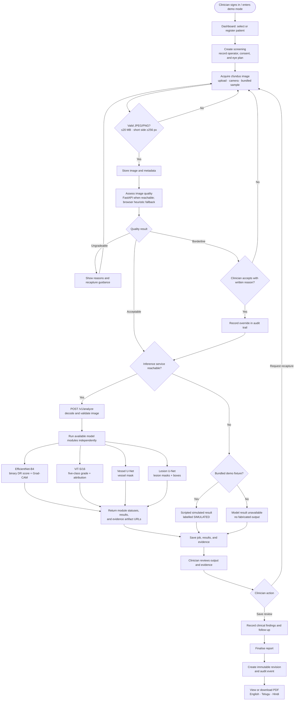

# GlucoIris screening workflow

An unavailable or failed model module does not substitute another module's output. The clinician can review available evidence and the report records missing modules.
