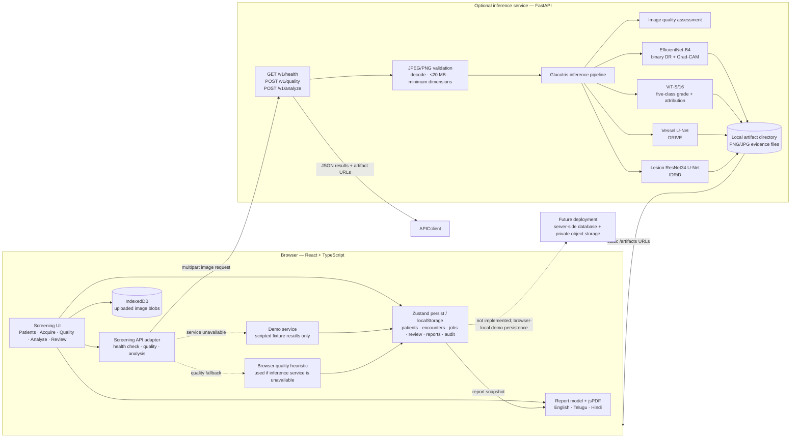

# GlucoIris system architecture

The inference service and trained modules are optional. Missing modules are reported as unavailable; demo predictions are limited to bundled fixtures and labelled simulated. Patient records and images are browser-local in the current app. PostgreSQL, private object storage, and a worker queue are future work.
